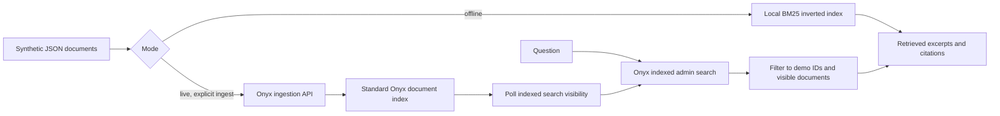

# Onyx indexed search

Ingest a small synthetic knowledge base, wait until its documents are searchable, and retrieve source excerpts with citations. The project demonstrates why knowledge is indexed before a question arrives: retrieval can search a prepared representation instead of asking every source application at query time.

Two modes share the same documents and evidence output:

- **Offline:** a deterministic BM25 inverted index implemented in Python. No server, model, package installation, key, or network call is needed.
- **Live:** a small client for the real [Onyx](https://github.com/onyx-dot-app/onyx) ingestion and indexed admin-search APIs. Onyx performs the indexing and retrieval. The client polls actual search visibility after ingestion and prints returned blurbs and source links.

This is a focused integration example. It does not recreate the Onyx platform, implement agents or MCP tools, run a code interpreter, or generate an LLM answer. The output is explicitly extractive evidence. The offline engine is a teaching implementation, not a substitute for Onyx's embedding, hybrid search, connector synchronization, or access controls.

## Run offline

Requires Python 3.10 or newer. All code and tests use the standard library.

```powershell
python -B indexed_search.py offline --query "telemetry retention expiry"
python -B indexed_search.py offline --query "incident escalation"
python -B -m unittest discover -s tests -v
```

The first query retrieves the synthetic policy stating that telemetry is retained for 30 days and removed by a daily cleanup job. Citations point to reserved `example.com` URLs identifying fictional documents; they are labels, not links to real policies. An unmatched query produces "No matching indexed evidence found."

## Data flow



## Run against Onyx

Use an existing **Standard Onyx** development instance, or follow the [official Docker deployment guide](https://docs.onyx.app/deployment/overview). Lite mode cannot index documents. No services are started by this repository.

For a new development installation, the upstream [Docker Compose README](https://github.com/onyx-dot-app/onyx/blob/a4ed03e6717c85b3d9d4e22196dbc4166e7b965e/deployment/docker_compose/README.md) supports checking out the source and running its Compose configuration. The following commands are manual setup instructions; review the upstream environment template before running them:

```powershell
git clone https://github.com/onyx-dot-app/onyx.git onyx
git -C onyx checkout --detach a4ed03e6717c85b3d9d4e22196dbc4166e7b965e
Set-Location .\onyx\deployment\docker_compose
Copy-Item env.template .env
```

Set `USER_AUTH_SECRET` in that `.env` to a fresh random secret before starting the instance. At the pinned commit authentication is always enabled and an empty secret prevents startup. A value can be generated with `python -c "import secrets; print(secrets.token_hex(32))"`. Configure any other values required by your environment, then run `docker compose up -d`. The supplied Compose file publishes the application at `http://localhost:3000`. This is a multi-service stack including a database, search index, inference servers, workers, object storage, and Redis; check upstream requirements before allocating resources. The upstream image tag defaults to `latest`, so a pinned source checkout alone does **not** pin the container images. Select and validate compatible image versions for a reproducible service deployment.

Complete the upstream administrator setup and obtain an API credential permitted to manage connectors **and** perform admin search (`manage:connectors` and `admin` at this revision). Credential availability depends on the upstream edition and account configuration. A restricted key can return 403. Configure the embedding/indexing models and verify that the Standard search services are healthy. This example does not create users, credentials, connectors, or model providers.

From this project's directory, provide the key only in the process environment:

```powershell
$env:ONYX_API_KEY = "replace-with-your-Onyx-development-key"
python -B indexed_search.py live --base-url http://localhost:3000/api --ingest --wait-seconds 90 --query "telemetry retention expiry"
```

`--ingest` upserts the three reserved `onyx-indexed-search-demo-*` document IDs. Repeating it updates those synthetic documents. Use a disposable development instance; upstream's default ingestion pair is public. If your administrator provides an existing connector-credential pair, pass `--cc-pair-id 17` with `--ingest`. The example does not create or delete that pair, and leaves the three sample documents in the index. Omit `--ingest` on later searches:

```powershell
python -B indexed_search.py live --base-url http://localhost:3000/api --query "incident escalation"
```

The default URL includes `/api` because upstream's Nginx proxy strips that prefix before routing to the backend. A directly exposed backend may instead use `http://localhost:8080`. An operator-configured `API_PREFIX` must also be included in the base URL.

The live client calls synchronous ingestion and then polls **search results**, not a database-list endpoint. A successful ingestion response alone does not establish search visibility. Readiness checks the presence of all three sample IDs; it does not prove an exact embedding-model version or index generation, and previously indexed IDs may already be visible on a repeat run. Each search applies a project metadata tag; the client also discards unrelated IDs, duplicates, and hidden documents. Admin search itself is privileged and intentionally includes hidden documents upstream, so this is an administration tutorial rather than an end-user authorization boundary.

Requests use finite timeouts and a two-MiB response limit. All redirects are refused, environment proxies are disabled, and non-loopback connections require HTTPS. Error bodies are not printed because a server could echo credentials. The client does not fetch returned citation links or execute document text. It sends only the supplied synthetic JSON and queries to the explicitly configured Onyx API.

## CODE MAP

| File | Responsibility and connections |
| --- | --- |
| `indexed_search.py` | CLI, strict synthetic-data loading, offline BM25 index, bounded Onyx HTTP client, ingestion/readiness/search workflow, and citation rendering. Reads the JSON fixture. |
| `verify_contract.py` | Parses actual upstream Python model and route definitions with `ast`, checks the pinned Git revision, verifies 24 consumed schema fields and two POST routes, and checks fixtures against upstream required fields. Imports the fixture loader; does not start or import the upstream application. |
| `tests/test_indexed_search.py` | Deterministic retrieval checks and local HTTP integration tests for requests, timeout, redirects, proxy bypass, malformed responses, result filtering, and readiness deadlines. Uses no external network. |
| `data/sample_documents.json` | Three fictional documents about retention, incidents, and indexing. Required marker text lets the live client check that every sample is visible. |
| `requirements.txt` | Documents Python's standard-library-only dependency policy. |
| `.gitignore` | Excludes credentials, environments, caches, generated data, and logs. |
| `UPSTREAM.md` | Exact upstream revision, inspected source contracts, licensing context, and verification limits. |
| `LICENSE` | MIT terms for this independently implemented example. |
| `README.md` | Scope, architecture, usage, and source map. |

## Verify the actual upstream contract

The tests mock HTTP behavior; they do not prove a real server is operational. Separately validate the API schema shape against the pinned upstream source checkout:

```powershell
python -B verify_contract.py C:\path\to\onyx
```

The checker fails on a different commit, a consumed field/type/default change, missing required document fields, or changed routes. It uses AST inspection of the actual schema definitions rather than importing Onyx's service dependencies. It does not evaluate all Pydantic validators or all optional schema fields; the server remains authoritative. See [UPSTREAM.md](UPSTREAM.md) for the exact references and what was tested.

HTTP 401 indicates an invalid credential; 403 indicates insufficient permissions; 404 commonly indicates a proxy-prefix or version mismatch; 501 commonly indicates Lite mode. Connectivity or readiness failures exit nonzero. Check server logs and the upstream administration UI before retrying ingestion.
